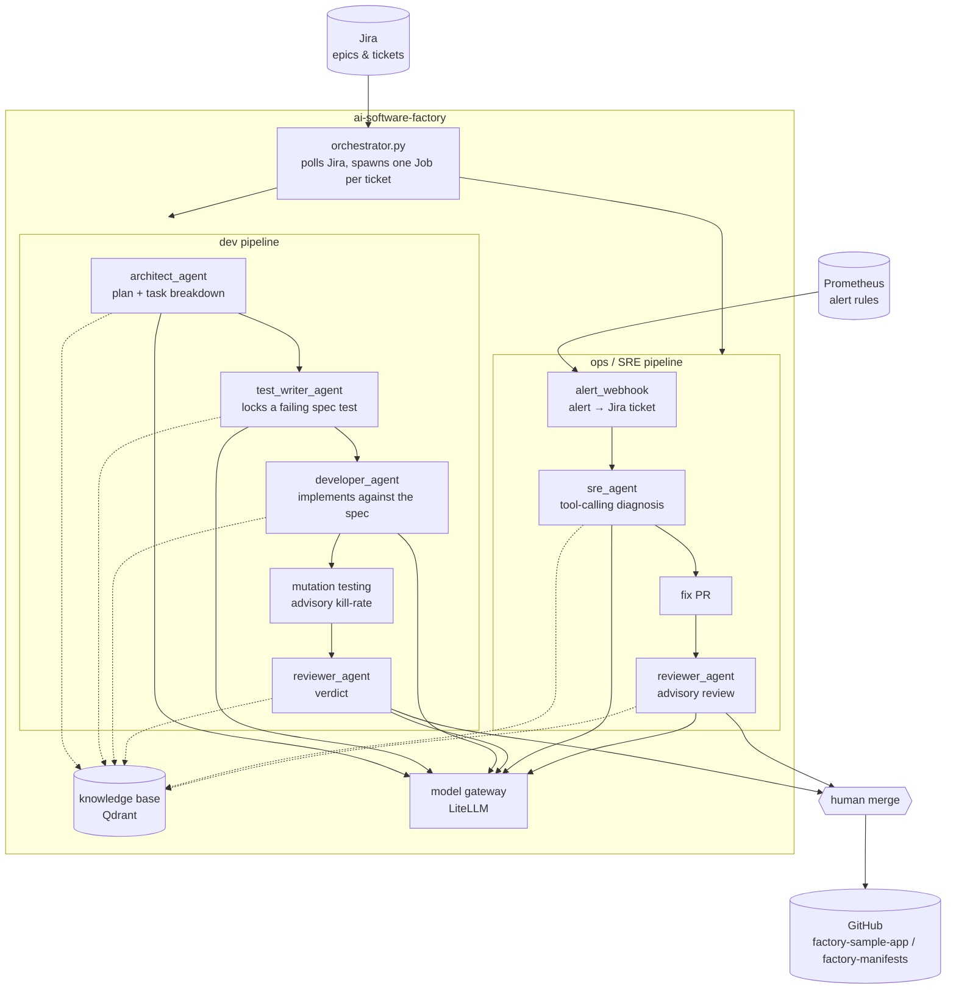
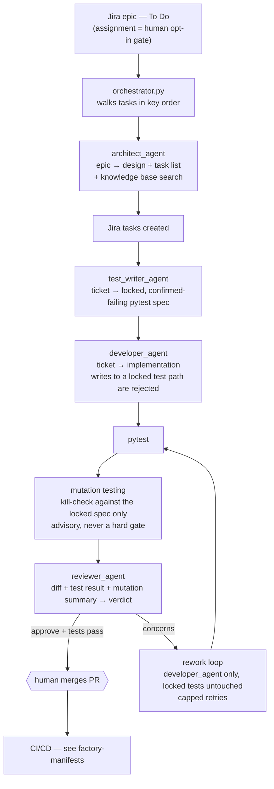
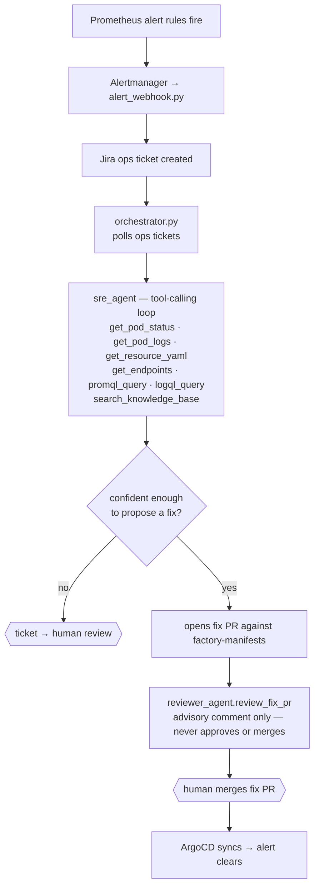

# ai-software-factory

A multi-agent pipeline that takes a Jira ticket from requirement to deployed, tested, reviewed production code — for both new feature development and live incident response — without a human writing the application code by hand.

It drives two loops against [`factory-sample-app`](https://github.com/egaraev/factory-sample-app) and its GitOps repo, [`factory-manifests`](https://github.com/egaraev/factory-manifests): a **development pipeline** that turns a Jira epic into reviewed, merged, deployed code, and an **operations pipeline** that turns a live Prometheus alert into a diagnosed, fixed incident. Both share one model gateway and one knowledge base.

## Architecture



Every agent call goes through one gateway, never to a model directly — and every agent queries the same knowledge base before it plans, writes, or reviews anything.

## Model gateway

One LiteLLM instance (`litellm.ai-models.svc.cluster.local:4000`) fronts both a local inference server (llama-swap, several models swapped on demand) and OpenRouter, so each agent asks for a role-based alias instead of a specific model:

| Alias | Backend | Used by | Why |
|---|---|---|---|
| `fx-code` | local | `developer_agent` | implements tickets as file-block diffs |
| `fx-verify` | hosted, independent model family | `sre_agent`, `reviewer_agent.review_pr` | a real second opinion — never the same family that wrote the code |
| `fx-review` | hosted, independent model family | `architect_agent`, `reviewer_agent.review_fix_pr` | design planning and SRE fix review, a third family again |
| `nomic-embed-text-v1.5` | local | `knowledge_client`, vault ingestion | 768-dim embeddings for the knowledge base |

Independent model families at each review step is deliberate: a reviewer never grades the same model's own homework.

## Dev ticket pipeline



The test-first ordering is the load-bearing design choice: a spec test is written and confirmed *red* before any implementation exists, then locked so rework can't quietly rewrite the test to match broken code. Mutation testing is advisory context for the reviewer, not a gate — the only hard, deterministic gate is a failing test, which always forces a `CONCERNS` verdict regardless of what the model says.

## Ops / SRE pipeline



`sre_agent` only ever reads — pod status, logs, live manifests, metrics, and the knowledge base, through a capped tool-calling loop. It never writes to the cluster directly; a proposed fix always goes through a PR and a human merge.

## Knowledge base

A Qdrant collection fed from a small, hand-curated standards vault (architecture conventions, review standards, operational runbooks) and queried by every agent — the architect when it plans, the developer and test-writer when they implement, both reviewers when they judge a diff, and `sre_agent` when it diagnoses an incident. Retrieval happens at prompt-build time (a `knowledge_client.search(...)` call) rather than as a tool the model chooses to invoke, except for `sre_agent`, where it's an explicit tool alongside the live-cluster ones.

## Repository layout

```
orchestrator.py        polls Jira / ops tickets, spawns a Job per item
architect_agent.py      Jira epic -> design + task breakdown
test_writer_agent.py    ticket -> locked, confirmed-failing pytest spec
developer_agent.py      ticket -> implementation (file-block diffs)
reviewer_agent.py       diff + tests (+ mutation summary) -> verdict
sre_agent.py            alert diagnosis + fix-PR proposal, tool-calling
repo_ops.py             git clone/commit/push, test running, mutation testing
github_client.py        GitHub API (PRs, reviews, comments)
jira_client.py          Jira API (epics, tasks, tickets, transitions)
knowledge_client.py     Qdrant search used by every agent above
context7_client.py      live library documentation lookups for developer_agent
alert_webhook.py        Alertmanager webhook -> Jira ops ticket
promote_staging.py      staging health check -> production promotion (see factory-manifests)
scorecard.py            repo-health metrics (lint/coverage/complexity/vulnerabilities)
dora_metrics.py         DORA metrics from git deploy history + Jira ops tickets
graph.py                dev-pipeline state machine
```

## Setup

```bash
pip install -r requirements.txt
cp env.sample .env   # JIRA_*, GITHUB_TOKEN, LITELLM_KEY, ...
```

Each pipeline entry point (`orchestrator.py`, `sre_agent.py`, `promote_staging.py`, `scorecard.py`, `dora_metrics.py`) is designed to run as a Kubernetes CronJob — see `factory-manifests/k8s/orchestrator/` for the schedules and `factory-manifests/k8s/sre-agent/` for the ops pipeline's RBAC.
